<p align="center">
  
</p>

<p align="center">
  <strong>Autonomous Agentic Coding CLI with Native Speed & Complete Tool Sovereignty</strong>
</p>

<p align="center">
  <a href="https://github.com/ngodeai/NgodeAI-CLI/releases"></a>
  <a href="https://www.npmjs.com/package/@ngodeai/coding-agent"></a>
  <a href="https://github.com/ngodeai/NgodeAI-CLI/blob/main/LICENSE"></a>
  <a href="https://bun.sh"></a>
  <a href="https://www.rust-lang.org"></a>
  <a href="https://www.typescriptlang.org"></a>
</p>

---

## ⚡ Overview

**NgodeAI CLI** is an advanced, production-grade agentic coding assistant designed directly for the terminal. Built on top of a performance-critical **Rust engine (~80k lines of native code)** and a modern **TypeScript/Bun runtime**, NgodeAI operates with genuine autonomy: reading context, diagnosing errors, executing commands, refactoring ASTs, and spawning parallel subagents.

Unlike simple chatbot wrappers, NgodeAI treats your workspace as a living environment — inspecting git trees, hooking into Language Server Protocols (LSP), attaching Debug Adapters (DAP), and rendering differential streaming diffs with zero terminal flicker.

```
+-------------------------------------------------------------------------+
|                              NgodeAI CLI                                |
+-------------------------------------------------------------------------+
|  Interactive TUI (Differential)  <--->  Headless / CI / Pipe Mode       |
+-------------------------------------------------------------------------+
|                  Autonomous Runtime & Tool Engine                       |
|   * read / write / edit          * tree-sitter AST & patch engine       |
|   * persistent bash / pty jobs   * Language Server Protocol (LSP)       |
|   * parallel subagent swarm      * Debug Adapter Protocol (DAP)         |
+-------------------------------------------------------------------------+
|                Native Rust Core (ngode-natives)                         |
|   * High-speed ripgrep           * Fast git & ignore walkers            |
|   * SIMD line search & hashing   * Tokenizer & embedding models         |
+-------------------------------------------------------------------------+
|                 60+ AI Providers & Model Catalog                        |
|   Anthropic · OpenAI · Google Gemini · DeepSeek · Ollama · Groq · Azure |
+-------------------------------------------------------------------------+
```

---

## ✨ Key Features

- **⚡ Native Rust Core Acceleration**: Native SIMD-accelerated text search, ripgrep integration, git diff inspection, and path walking via `@ngodeai/natives`.
- **🤖 Multi-Provider & Model Agnostic**: Native compatibility with **60+ AI providers** — Anthropic (Claude 3.7 / 3.5), OpenAI (GPT-4o, o1, o3-mini), Google Gemini 2.0 / 2.5, DeepSeek (V3, R1), Ollama local models, OpenRouter, Mistral, and more.
- **🛠️ Surgical AST & Hashline Edits**: Never suffers from hallucinated line shifts. Edits are verified with cryptographic snapshot tags and applied through AST-aware transformations.
- **🐝 Parallel Subagent Swarms**: Break down complex features or large codebases into independent subtasks (`scout`, `reviewer`, `task`) running concurrently without context bloating.
- **🖥️ Differential Terminal UI (TUI)**: Custom terminal renderer optimized for high refresh rates, clean scrollback retention, syntax-highlighted diffs, and live-streaming tool call widgets.
- **🔌 Built-In LSP & DAP Integration**: Understands project definitions, hover types, references, diagnostics, and debugging breakpoints across TypeScript, Python, Rust, Go, C++, and Java.
- **🔒 Privacy & Local-First**: Keys and session logs remain strictly on your machine under `~/.ngodeai/`. Local models via Ollama or custom endpoints work out of the box with zero cloud dependency.

---

## 🚀 Quickstart

### 1. Installation

#### Automatic Script (macOS / Linux / WSL)
```bash
curl -fsSL https://ngodeai.net/install.sh | sh
```

#### Via Bun / npm
```bash
# Global install with Bun (Recommended)
bun add -g @ngodeai/coding-agent

# Or via npm
npm install -g @ngodeai/coding-agent
```

#### Run from Source
```bash
git clone https://github.com/ngodeai/NgodeAI-CLI.git
cd NgodeAI-CLI
bun install
bun run build:natives
bun packages/coding-agent/src/cli.ts
```

---

## 💻 Usage

### Interactive Mode
Launch the full interactive TUI session in your current project directory:
```bash
ngodeai
```

### Direct Instruction (One-Shot)
Execute a specific instruction and let NgodeAI inspect and edit your workspace:
```bash
ngodeai "Add comprehensive unit tests for the auth middleware"
```

### Piping / Non-Interactive (Headless)
Pipe error logs, diffs, or code directly into NgodeAI:
```bash
git diff | ngodeai -p "Review this diff for security risks and edge cases"
cat build.log | ngodeai -p "Diagnose why the build failed and suggest fixes"
```

### Model Selection & Thinking Effort
```bash
# Use Claude 3.7 Sonnet with high reasoning effort
ngodeai --model anthropic/claude-3-7-sonnet --thinking high

# Use DeepSeek R1 for architectural planning
ngodeai --model deepseek/deepseek-reasoner

# Use local Ollama model
ngodeai --model ollama/qwen2.5-coder:32b
```

---

## 🧰 Built-in Tool Ecosystem

NgodeAI ships with an integrated, hardened tool suite:

| Tool | Capability |
|---|---|
| `read` | Range-aware file reader supporting code, images, PDF, archives, and SQLite databases. |
| `edit` | Surgical, tagged hashline patches with collision detection. |
| `write` | Atomic file writer and new module generator. |
| `bash` | Persistent shell execution with PTY support, job streaming, and background task monitoring. |
| `grep` | Ultra-fast regex search backed by the native Rust ripgrep engine. |
| `glob` | Gitignore-aware, high-performance file tree discovery. |
| `task` | Spawns parallel worker subagents (`scout`, `reviewer`, `task`) for deep multi-file work. |
| `eval` | Embedded Python and JavaScript (Bun) sandbox for ad-hoc scripts and calculation. |
| `todo` | Deterministic phase and task tracker for complex multi-step execution. |

---

## ⚙️ Configuration & Environment

Configuration is stored in `~/.ngodeai/`:

- `~/.ngodeai/agent/config.yml` — Global configuration, model defaults, and tool preferences.
- `~/.ngodeai/history/` — Session transcripts and task checkpoints.
- `~/.ngodeai/logs/` — Rotating debug and telemetry logs.

### Key Environment Variables

| Variable | Description |
|---|---|
| `NGODEAI_API_KEY` / `OPENAI_API_KEY` | Primary API keys for LLM providers. |
| `ANTHROPIC_API_KEY` | Anthropic Claude API key. |
| `GEMINI_API_KEY` | Google Gemini API key. |
| `DEEPSEEK_API_KEY` | DeepSeek API key. |
| `NGODEAI_CONFIG_DIR` | Custom config directory path (default: `~/.ngodeai`). |
| `NGODEAI_PROFILE` | Named configuration profile to activate. |

*(Note: NgodeAI maintains full backward compatibility with legacy `NGODEAI_*` and `PI_*` environment variables).*

---

## 🏛️ Monorepo Structure

```
NgodeAI-CLI/
├── packages/
│   ├── coding-agent/     # Core CLI entrypoint, commands, and tool runtime
│   ├── ai/               # Multi-provider LLM client with streaming support
│   ├── catalog/          # Model registry, provider descriptors, and pricing rules
│   ├── agent/            # Agent state machine and loop management
│   ├── tui/              # Custom differential terminal UI engine
│   ├── natives/          # High-level bindings for native Rust operations
│   ├── stats/            # Local observability and usage metrics
│   ├── ngodetype/        # High-performance schema validation runtime
│   └── utils/            # Shared primitives, streams, paths, and logger
├── crates/
│   ├── ngode-natives/    # Rust crate for SIMD search, ripgrep, and git inspection
│   ├── ngode-builtins/   # Embedded shell tools and cross-platform POSIX utilities
│   ├── ngode-ast/        # Tree-sitter AST queries and code structure extractors
│   ├── ngode-vfs/        # Virtual and sandboxed filesystem abstraction
│   └── ngode-predict/    # Speculative local inference and fast tokenization
└── assets/               # Brand visual assets, icons, and wordmarks
```

---

## 🤝 Contributing

Contributions are welcome! Please check out [CONTRIBUTING.md](./CONTRIBUTING.md) for developer setup, coding guidelines, and testing procedures.

```bash
# Run type checks across all workspace packages
bun check:types

# Run test suite
bun test packages/utils/test
bun test packages/coding-agent/test/cli/completions.test.ts

# Test Rust core
bun run test:rs
```

---

## 📄 License

NgodeAI CLI is open-source software licensed under the [MIT License](./LICENSE).
---

<p align="center">
  <strong>Built with ❤️ by <a href="https://ngodeai.net">NgodeAI</a></strong>
</p>
