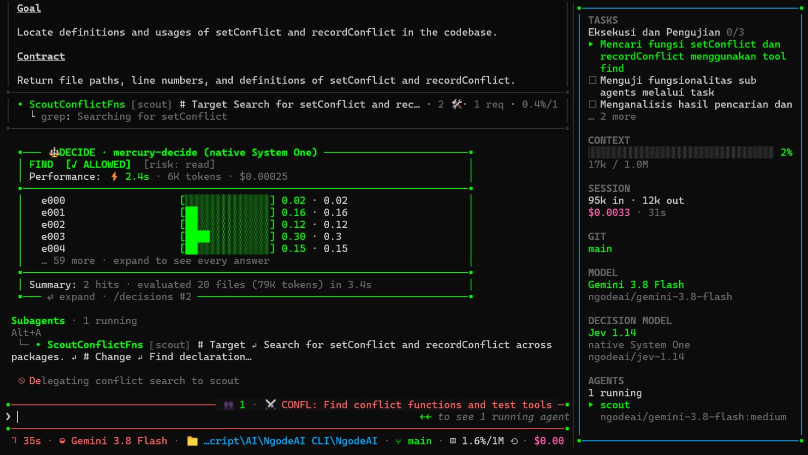
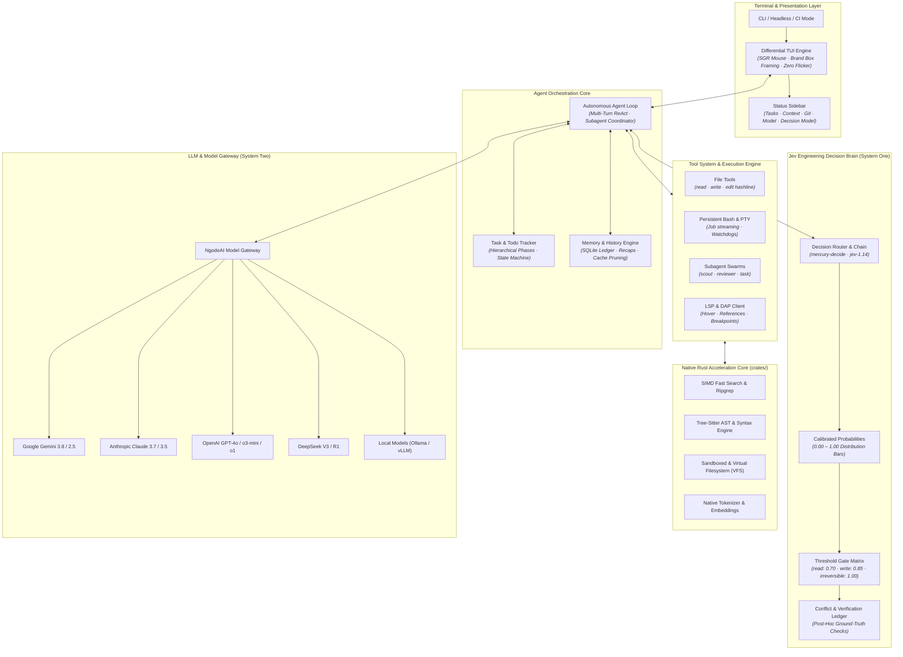
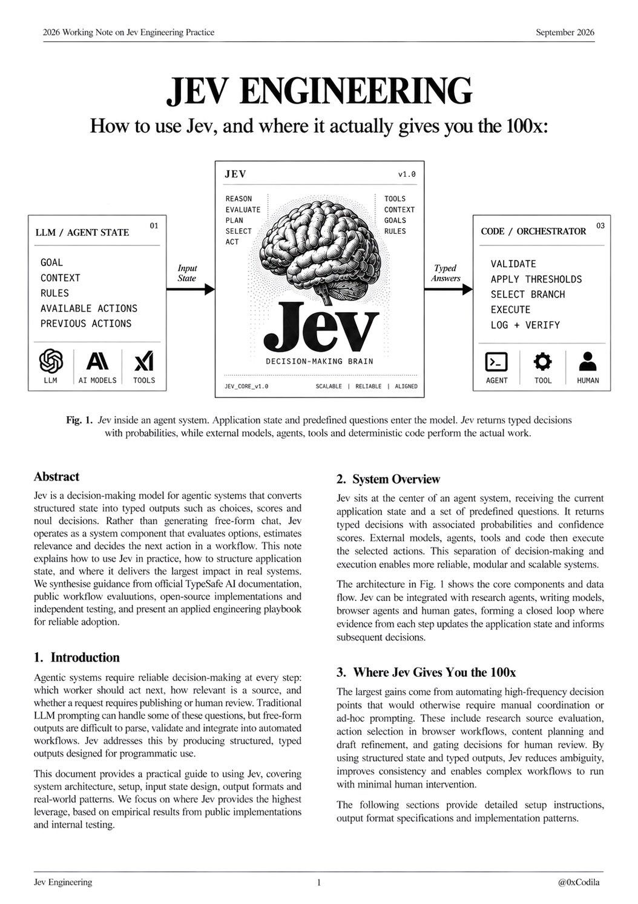

<p align="center">
  
</p>

<p align="center">
  <strong>Autonomous Agentic Coding CLI with System One Decision Intelligence & Complete Tool Sovereignty</strong>
</p>

<p align="center">
  <a href="https://github.com/ngodeai/NgodeAI-CLI/releases"></a>
  <a href="https://www.npmjs.com/package/@ngodeai/coding-agent"></a>
  <a href="https://github.com/ngodeai/NgodeAI-CLI/blob/main/LICENSE"></a>
  <a href="https://bun.sh"></a>
  <a href="https://www.rust-lang.org"></a>
  <a href="https://madewithjev.com/what-is-jev-engineering"></a>
</p>

---

## ⚡ Overview

**NgodeAI CLI** is an autonomous, production-grade agentic coding assistant designed directly for developers in the terminal. Powered by an ultra-fast **Rust core (~80,000 lines of native code)** and a modern **TypeScript/Bun runtime**, NgodeAI operates with true workspace sovereignty: inspecting git repositories, diagnosing compiler errors, refactoring syntax trees with AST awareness, executing persistent shell tasks, and dispatching parallel subagent swarms.

At the center of NgodeAI's autonomy is **Jev Engineering** — a disciplined separation between fast, calibrated decision-making (**System One**) and generative code synthesis (**System Two**). High-frequency workflow choices (tool gating, search relevance, human verification, route selection) are resolved by specialized decision models (`mercury-decide`, `jev-1.14`) in milliseconds at near-zero token cost, eliminating conversational prompt-drift and hallucinated actions.

---

## 🖥️ Live Terminal Interface

NgodeAI renders a high-performance differential TUI with zero flicker, strict brand-box aesthetics (`▪───▪` hairline borders), a live context & model status sidebar, and real-time decision telemetry:

<p align="center">
  
</p>

_Above: NgodeAI orchestrating an autonomous task with a background `scout` subagent, evaluating search relevance via the `mercury-decide` System One model, and maintaining persistent state across the live right-hand sidebar._

---

## 🏛️ System Architecture

NgodeAI separates user interaction, agent orchestration, decision intelligence, native performance primitives, and LLM providers into clear, decoupled layers:



---

## 🧠 Jev Engineering: The 100x Decision Paradigm

Traditional agentic workflows force an expensive, slow generative LLM to answer every micro-question ("Should I open this file?", "Is this hit relevant?", "Should I ask the user for confirmation?") inside the main conversational context. This causes massive prompt bloat, token wastage, high latency, and compounding reasoning errors.

NgodeAI implements **[Jev Engineering](https://madewithjev.com/what-is-jev-engineering)** — an applied architectural discipline that converts application states into strict, typed decisions:

<p align="center">
  
</p>

### Core Tenets of Jev in NgodeAI

1. **Separation of Decisions from Synthesis:**  
   Decisions (System One) are handled by dedicated models (`mercury-decide` or `jev-1.14`) that output calibrated choices, scores, and confidence probabilities instead of prose. Large generative models (System Two, e.g., Gemini 3.8 Flash, Claude Sonnet 3.7) are reserved strictly for synthesis and complex reasoning.
2. **Programmatic State Mapping:**  
   The workspace state (goals, rules, context, candidate files) is serialized into typed JSON inputs. Jev evaluates all options concurrently in a single request and returns exact probability distributions (rendered as visual ASCII/Unicode bars `[████████░░░░] 0.71`).
3. **Calibrated Gating Matrix:**  
   Every decision point is evaluated against a mathematical threshold matrix according to risk:
   - `read` actions: auto-approved when confidence $\ge 0.70$
   - `write` actions: require higher confidence $\ge 0.85$
   - `irreversible` actions (git reset, file deletion): never auto-approved without human confirmation
4. **Post-Hoc Conflict Detection:**  
   Predictions are continually verified against actual outcomes. If code execution disagrees with an approved action (e.g., a typecheck or test failure), a divergence conflict is recorded in the SQLite ledger (`/decisions conflicts`) to prevent repeated mistakes.
5. **Drastic Efficiency Gains:**  
   High-frequency tool checks run in milliseconds with **zero cost ($0.00000 Free Tier)** on `mercury-decide`, preserving your LLM context window for actual code generation.

---

## ✨ Key Features

- **⚡ Native Rust Performance**: SIMD line search, ripgrep regex engine, git tree inspection, and directory traversal running natively in Rust via `@ngodeai/natives`.
- **🤖 60+ AI Providers**: Built-in support for Google Gemini (3.8 Flash / 2.5), Anthropic Claude, OpenAI, DeepSeek, Groq, Cerebras, OpenRouter, Mistral, and local Ollama/vLLM endpoints.
- **🛠️ Tagged Hashline Surgical Edits**: Edits are pinned with cryptographic tags and verified with AST syntax checks — eliminating line drift and duplicate code insertion.
- **🐝 Parallel Subagent Swarms**: Spawn specialized independent workers (`scout` for read-only exploration, `reviewer` for code audits, `task` for isolated execution) that report back without bloating the main session context.
- **🖥️ Differential Terminal UI (TUI)**: Custom rendering with clean scrollback preservation, SGR mouse interaction, and distinct `▪───▪` box frames.
- **🔌 Built-In LSP & DAP Protocols**: Native code intelligence across TypeScript, Python, Rust, Go, C++, and Java — resolving definitions, references, hover types, and debugging breakpoints.
- **🔒 Local-First Privacy**: Keys, decision ledgers, and session history remain strictly local on your workstation under `~/.ngodeai/`.

---

## 🚀 Quickstart

### 1. Installation

#### Global Install via Bun (Recommended)

```bash
bun add -g @ngodeai/coding-agent
```

#### Global Install via npm

```bash
npm install -g @ngodeai/coding-agent
```

#### Run from Source

```bash
git clone https://github.com/ngodeai/NgodeAI-CLI.git
cd NgodeAI-CLI
bun install
bun run build:natives
bun packages/coding-agent/src/cli.ts
```

---

## 💻 Usage Examples

### 1. Interactive Terminal Session

Launch the full interactive TUI in your project directory:

```bash
ngodeai
```

### 2. Direct Instruction (One-Shot)

Execute an autonomous task directly from your shell:

```bash
ngodeai "Add comprehensive integration tests for the auth service and fix any failures"
```

### 3. Piping & Headless CI Mode

Stream logs, diffs, or files into NgodeAI for non-interactive analysis:

```bash
git diff | ngodeai -p "Review this diff for security vulnerabilities and performance bottlenecks"
cat build.log | ngodeai -p "Identify the root cause of this compiler error and output the patch"
```

### 4. Model Selection & Reasoning Effort

```bash
# Default: Google Gemini 3.8 Flash with Mercury Decide
ngodeai

# Use Claude 3.7 Sonnet with high thinking effort
ngodeai --model anthropic/claude-3-7-sonnet --thinking high

# Use DeepSeek R1 for deep architectural analysis
ngodeai --model deepseek/deepseek-reasoner

# Run offline with local Ollama
ngodeai --model ollama/qwen2.5-coder:32b
```

### 5. Managing Decision Intelligence

Inspect the Jev decision ledger directly from the CLI:

```bash
# View backend status, cache hit rates, and gate thresholds
/decisions status

# Inspect all recorded decisions in this session
/decisions

# View recorded conflicts where predictions diverged from code execution
/decisions conflicts

# Run an empirical benchmark comparing batched vs sequential decision efficiency
/decisions bench batch
```

---

## 🧰 Built-in Tool Suite

NgodeAI ships with a hardened, native tool suite:

| Tool    | Capability                                                                                    |
| ------- | --------------------------------------------------------------------------------------------- |
| `read`  | Range-aware reader for source code, images, PDF documents, archives, and SQLite tables.       |
| `edit`  | Surgical hashline patcher with cryptographic snapshot tags and collision detection.           |
| `write` | Atomic file writer and new module generator.                                                  |
| `bash`  | Persistent shell execution with PTY support, job streaming, and background process control.   |
| `grep`  | Ultra-fast regex search backed by the native Rust ripgrep engine.                             |
| `glob`  | Gitignore-aware, high-speed file tree exploration.                                            |
| `task`  | Spawns parallel worker subagents (`scout`, `reviewer`, `task`) for deep multi-file execution. |
| `eval`  | Sandboxed Python and JavaScript (Bun) REPL for scratchpad calculations and scripts.           |
| `todo`  | Deterministic phased task tracker for complex multi-step execution.                           |
| `ask`   | Interactive human-in-the-loop clarification dialog with gated decision recording.             |

---

## ⚙️ Configuration & Environment

Settings and state are maintained in `~/.ngodeai/`:

- `~/.ngodeai/agent/config.yml` — Global configuration, model defaults, and tool preferences.
- `~/.ngodeai/cache/decisions.db` — SQLite ledger storing every decision, score, and conflict.
- `~/.ngodeai/agent/history.db` — Session history, turn checkpoints, and prompt logs.
- `~/.ngodeai/logs/` — Daily rotating debug and telemetry logs.

### Key Environment Variables

| Variable                            | Description                                                  |
| ----------------------------------- | ------------------------------------------------------------ |
| `NGODEAI_API_KEY`                   | Primary API key for the NgodeAI Gateway and decision models. |
| `GEMINI_API_KEY` / `GOOGLE_API_KEY` | Google Gemini API key.                                       |
| `ANTHROPIC_API_KEY`                 | Anthropic Claude API key.                                    |
| `OPENAI_API_KEY`                    | OpenAI API key.                                              |
| `DEEPSEEK_API_KEY`                  | DeepSeek API key.                                            |
| `NGODEAI_CONFIG_DIR`                | Custom config directory path (default: `~/.ngodeai`).        |
| `NGODEAI_PROFILE`                   | Named configuration profile to activate.                     |

---

## 🏛️ Monorepo Structure

```
NgodeAI-CLI/
├── packages/
│   ├── coding-agent/     # Core CLI entrypoint, commands, and runtime orchestration
│   ├── ai/               # Multi-provider LLM client, streaming, and native decision wires
│   ├── catalog/          # Model registry, provider descriptors, and KDL compat rules
│   ├── agent/            # Autonomous agent state machine and execution loop
│   ├── tui/              # Custom differential terminal UI with brand-box framing
│   ├── natives/          # High-level bindings for native Rust operations
│   ├── stats/            # Local observability dashboard and telemetry sync
│   ├── ngodetype/        # High-performance ArkType-compatible schema validation runtime
│   └── utils/            # Shared primitives, streams, paths, and structured logger
├── crates/
│   ├── ngode-natives/    # Rust crate for SIMD search, ripgrep, and git inspection
│   ├── ngode-builtins/   # Embedded shell tools and cross-platform POSIX utilities
│   ├── ngode-ast/        # Tree-sitter AST queries and code structure extractors
│   ├── ngode-vfs/        # Virtual and sandboxed filesystem abstraction
│   └── ngode-predict/    # Speculative local inference and fast tokenization
└── assets/               # Brand visual assets, icons, and architecture diagrams
```

---

## 📄 License & Open-Source Attribution

NgodeAI CLI is open-source software licensed under the **[MIT License](./LICENSE)**.

### Acknowledgments & Heritage

NgodeAI is derived from and builds upon the foundational architecture of **[Oh My Pi (OMP)](https://github.com/can1357/oh-my-pi?tab=MIT-1-ov-file)**, originally created by **[Stencil Labs, Inc.](https://stencil.so)** and **Mario Zechner** under the MIT License:

```text
Copyright (c) 2026 NgodeAI (https://ngodeai.net)
Copyright (c) 2024-2026 Stencil Labs, Inc. (https://stencil.so)
Copyright (c) 2024-2026 Mario Zechner
```

We express deep gratitude to the OMP creators, contributors, and the open-source community for pioneering sovereign agentic coding infrastructure.

---

<p align="center">
  <strong>Built with ❤️ by <a href="https://ngodeai.net">NgodeAI</a></strong>
</p>
